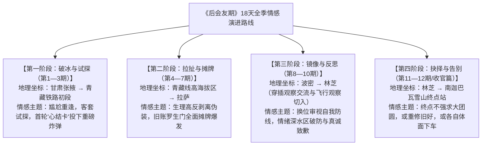
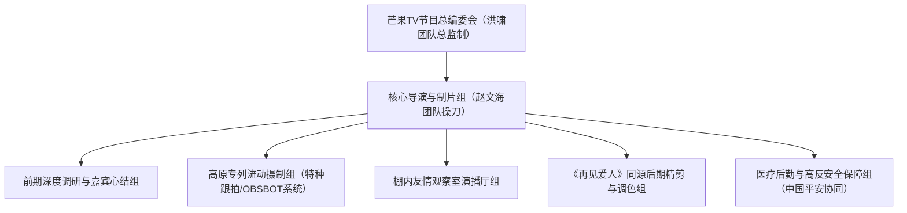

# 《后会友期——大型成年人友情治愈纪实真人秀》策划案

---

## 一、节目核心信息概览

### （一）节目名称与命名内涵
- **节目名称**：《后会友期》（英文名：*I Miss You*，项目筹备期暂定名《再见朋友》）
- **命名内涵**：
  “后会友期”化用汉语成语“后会有期”，将“有”易为“友”，一字之差直指成年人社交世界最深沉的叩问——那些在时光流转、利益错位或误解沉默中渐行渐远的故人，究竟是“后会有期”的重逢序曲，还是“各自珍重”的体面终章？节目不追求浮于表面的大团圆，而是为走散的旧友提供一次认真告别或重启关系的时空锚点。

### （二）节目口号（Slogan）
> **“终点未至，后会友期。”**

### （三）节目类别
- **题材外壳**：当代成年人“过期友情”与人际疏离
- **驱动机制**：高原长途专列密闭空间共处 + 双线情感观察解剖 + 非强制性抉择机制
- **形态属性**：大型成年人友情治愈纪实真人秀（行业常称为友情版“情感深水区纪实观察节目”）

### （四）节目体量
- **季播期数**：单季共 **13期**（含正片12期及衍生畅享/加更特别篇，量词严格规范用“期”）
- **单期时长**：**90分钟至115分钟**（以深度纪实长片体量承载细腻情绪，如首期正片时长达 **113分钟**）

### （五）播出平台与编排时段
- **播出平台**：**芒果TV** 全网独播
- **上线编排**：2026年10月22日起，**每周四中午 12:00** 正片准时上线；每周五至周日穿插上线《后会友期》加更畅享版与观察室纯享解析片段，贴合都市青年午间通勤与周末沉浸式追综习惯。

### （六）受众画像与分层定位
1. **核心受众（18—35岁都市青年与社会化洗礼人群）**：
   - **群体构成**：初入或深耕职场的都市白领、高校毕业生、Z世代女性用户及情感观察类内容高频受众。
   - **心理痛点**：身处高频社交却情感高度孤立的现代社会，通讯录躺着上千个“好友”却再无深夜畅聊之人；普遍经历过“友情无疾而终”、“因尴尬误会单删拉黑”、“人生步调错位而渐行渐远”的隐痛，渴望在他人故事中寻找代偿性情绪出口与社交边界参考。
   - **定位动因**：以极度真实、撕开体面的友情剖析切中社会集体共鸣，填补国内长视频赛道长期聚焦婚恋、忽视友情的题材空白。
2. **辐射受众（36—50岁中青年人群与泛文化纪实受众）**：
   - **群体构成**：经历过半生聚散的中青年观众、心理学爱好者及高原人文风光爱好者。
   - **心理诉求**：看重节目的人文深度、社会学洞察力以及川藏青藏沿线的极致自然风光治愈感，对“聚散有时”的生命哲学产生深刻共鸣。

---

## 二、节目背景与策划动因

### （一）主流价值观引领与社会心理关照
随着社会高速流动与职场生活节奏加快，当代青年的精神孤独感与人际关系脆弱性日益凸显。响应广电总局“观照现实生活、反映人民真情实感、抵制虚假剧本与过度娱乐化”的创作导向，文艺创作亟需把镜头从脱离地气的“工业糖精”转向具有社会切片意义的真实人性表达，引导公众以健康、理性、真诚且有边界感的态度处理人际关系。

### （二）荧屏市场现状与赛道蓝海痛点
纵观近年视听综艺市场，“情感观察赛道”高度集中于婚恋、夫妻与婆媳代际关系，“恋爱修罗场”层出不穷，同类节目已显疲态；与此同时，同样作为人类三大亲密关系核心支柱的**“成年人友情”**却长期停留在浅层“熟人局旅游团综”的嘻哈打闹中，鲜有节目敢于直面友情的破裂、嫉妒、错位、背叛与遗憾。

### （三）受众心理洞察与情感诉求
成年人的友情不像爱情那样有一纸婚书或明确的分手仪式，大多数友情的消逝都是“在某一个瞬间悄无声息地走散”。人们既怀念曾经赤诚相待的彼此，又囿于面子与心结难以主动破冰。观众迫切需要一档“不按头和好、允许遗憾存在”的清醒纪实节目，替他们说出那句未曾说出口的质问或告别。

### （四）承上启下立项句
**基于此，芒果TV集结洪啸监制团队与赵文海制作团队，并联合资深情感纪实后期班底，拟于2026年第四季度重磅推出大型成年人友情治愈纪实真人秀《后会友期》，旨在通过18天高海拔高原专列的极限共处，剥离成年人的社交伪装，带领四对走散旧友完成一场直面心结、重塑边界或体面告别的真实之旅。**

---

## 三、节目宗旨与核心立意

### （一）节目宗旨与价值导向
坚守“去剧本化、去工业糖精、真实记录”的纪实初心，严格贯彻落实广电文艺管理规范，不刻意制造低俗撕扯，不强行编排廉价的“大团圆结局”。以尊重真实人性规律为最高准则，引导观众正确认识友情中的自私、敏感、委屈与成长落差。

### （二）核心立意与精神赋能
1. **打破“必须圆满”的社交绑架**：传递“人生是列单向行驶的火车，有人陪你一程，有人中途下车，皆是常态”的豁达哲学；
2. **探讨健康边界与自我和解**：通过外部旧友的镜照，促使嘉宾与观众向内审视自我依恋模式，理解“所有的关系难题，归根结底都是与自己相处的方式”。

---

## 四、节目核心特色与创新维度

### （一）空间与模式创新：“18天高原专列 + 密闭双人包厢”极端场域压迫
彻底跳出常规酒店民宿的松散布局，将核心叙事场域锁定在一列**跨越18天、由甘肃张掖出发开往青藏高原（经拉萨、波密、林芝至南迦巴瓦雪山）的高原专列**上：
- **空间压缩效应**：专列狭小的“双人包厢”与流动“餐车”，剥夺了现代人惯用的“逃避、冷处理、看手机躲避尴尬”的退路，迫使积怨多年的旧友在物理近距下直面彼此；
- **生理极限去伪**：高海拔旅途的疲惫感与高原反应带来的生理脆弱，极大削弱了艺人与嘉宾的“表演欲”和社交防线，催生最本能、最滚烫的真情流露与情绪爆发。

### （二）叙事语态升级：“双线解剖”与微表情极细刻画
延续芒果系情感纪实天花板级制作基因（《再见爱人》核心班底及后期精剪团队护航）：
- **无提纲、零彩排实录**：旅行前不预设矛盾走向，完全依靠真实互动的自然发酵；
- **情绪留白与心理切片**：通过多机位精准抓取叹息、眼神躲闪、手指绞紧、强忍泪水等微观细节，搭配棚内观察室的即时心理拆解，让一段沉默具备千钧重量的戏剧张力。

### （三）高新影像技术赋能：无干扰AI智能云台全覆盖
针对列车车厢极其狭窄、传统扛机摄影师入驻会严重破坏真实氛围的制作痛点，节目全面引入 **OBSBOT 寻影智能追踪影像系统**，在双人包厢与餐车角落实现隐蔽化、无人化 AI 自动构图与人脸跟拍；同时引入**首席AI助手“千问”**辅助行程信息汇总与多维情感线索梳理，保证真实场域的“零打扰窒息感”。

### （四）规则底色创新：“不强制和解”与“提前下车”机制
将关系走向的绝对控制权交还给当事人本人——在18天旅途中，只要谈开或确认无法再同行，嘉宾随时可以行使选择权，或提前下车，或在终点雪山下体面告别。

---

## 五、角色设置与核心阵容配置

### （一）旅行嘉宾矩阵（四组真实“过期友情”旧友样本）
节目精准选取覆盖不同圈层、不同代际、不同断裂成因的四对真实旧友，构建丰富的社会关系切面：

1. **昔日同门战友型 · 许飞 & 厉娜**
   - *关系溯源*：2006年《超级女声》同届战友，曾形影不离；后因早年“私密谈话疑遭泄密传至公司”的心结，陷入长达十余年的断联与形同陌路。
   - *核心看点*：十余年积怨的“罗生门”现场对质，揭开年轻时因自我保护与误解导致的“画地为牢”式执念。
2. **职场人情错位型 · 马天宇 & 张萌**
   - *关系溯源*：因拍戏结缘的圈内老友，因昔日张萌转型制片人邀戏未果的一句气话，导致马天宇直接微信单删，断联近十年。
   - *核心看点*：剖析演艺圈及成年人职场中“工作合作”与“私人情谊”混杂时的脆弱性，直面微信单删背后的敏感与委屈。
3. **同龄闺蜜拉扯型 · 王子璇 & 文吉儿**
   - *关系溯源*：曾互为彼此重要精神支柱的青年挚友，因成长步调差异、日常付出不对等感以及情绪表达错位而渐渐疏离。
   - *核心看点*：极具Z世代女性社交代表性的“隐形消耗”与内耗拉扯，讨论好朋友之间究竟需要多少坦诚与界限。
4. **青春竞合双子星 · 白小纯 & 青稚**
   - *关系溯源*：曾经在电竞赛场上并肩作战、意气风发的“双子星”少年挚友，随着各自职业身份转换与赛场竞争压力，由亲密战友转为沉默的陌生人。
   - *核心看点*：展现男性青年及电竞圈在理想主义褪色后，面临名利竞合与角色转变时的傲娇、愧疚与难以启齿。

### （二）棚内友情观察团（理性拆解与感性共情并重）
- **观察室主理人 / 领衔观察**：**张泉灵**（资深媒体人、前总台持证专业主持人，以犀利通透、精准直击问题本质的提问与点评统领全场，同时具备跨界参与实景沟通的强大引导力）；
- **常驻明星观察员**：**李维嘉**（老牌专业主持人，控场细腻温暖）、**周笔畅**（同届超女亲历者视角，共情力极强且清醒通透）、**苏醒**（幽默敏锐、善于换位剖析男性社交逻辑）、**黄子弘凡**（青年活力视角，代表Z世代鲜活态度）、**黄婷婷**（女性细腻共情视角）；
- **学术权威观察员**：**喻丰**（知名心理学教授，从“依恋类型”、“基本归因偏差”、“心理防御机制”等专业心理学理论出发，将个案升华为普适人际法则）。

### （三）权威幕后制作班底
- **总监制团队**：**洪啸团队**（芒果TV王牌内容掌舵团队，把控全局立意与叙事高度）；
- **总导演 / 制片人**：**赵文海团队**（深耕职场与纪实真人秀赛道的先锋团队，具备敏锐的社会情绪捕捉力与高度网感）；
- **后期精剪团队**：原《再见爱人》核心剪辑与情感叙事团队（确保心理张力拉满与节奏精准）。

---

## 六、核心任务规则与赛制机制

### （一）规定情境与路线规划
- **核心旅途**：18天高原铁路长途拉练（张掖启程 → 青藏铁路沿线 → 拉萨 → 波密 → 林芝 → 终点南迦巴瓦雪山）。
- **物理场域轮转**：
  - *双人私密包厢*：仅限每对旧友二人独处，无第三方缓冲，强制触发深度面对面；
  - *公共餐车与驻地*：四对旧友合体互动，在观察“别组朋友”的镜像对照中反观自身问题。

### （二）核心催化道具与三大推进机制
1. **“心结卡”书写与现场宣读机制**：
   - 规定嘉宾在无任何彩排与提纲提示下，凭第一直觉写下关于对方“最耿耿于怀的一件事”、“曾经最受伤的一句话”或“十年来最想问出的真相”。在列车餐车或雪山营地现场拆卡宣读，撕开客套面具，展开不设防交锋。
2. **深度心理问答破冰（“心灵36问”变体机制）**：
   - 在关系陷入冷战僵局时，引入由心理学专家参与设计的阶梯式互问卡，从客观事实回忆层层推进至内心脆弱剖析（如：“如果今天是我们此生最后一次见面，你最希望我记住你什么？”）。
3. **自由抉择与“提前下车”机制**：
   - 不设任何淘汰晋级赛制，杜绝恶俗投票打榜。旅途中设定阶段性抉择站点：若双方均认为心结已解、无需再耗，可选择携手**提前下车**；若一方或双方确认旧伤难愈、无法继续同行，亦可随时决定各自下车或坚持抵达终点后做最后道别。

---

## 七、整体季播脉络与单期全流程执行方案

### （一）全季18天旅途情感演进地图

---

### （二）典型单期全流程执行方案：第一期《张掖启程·故人重逢》
- **本期时长**：**113分钟**（沉浸式首播加长体量）
- **核心地点**：甘肃张掖车站专列站台、青藏高原专列餐车及1—4号双人包厢、芒果TV棚内友情观察室
- **时序结构与流程拆解**：

#### 1. 第一阶段：站台集结·十余年后的第一声招呼（约20分钟）
- **真实纪实开篇**：四组嘉宾各自怀揣忐忑与防备独立前往张掖站台。无主持人提前暖场，利用隐蔽机位记录老友迎面撞见瞬间的微表情凝固、寒暄卡壳与假装忙碌看行李。
- **典型名场面**：马天宇与张萌十年未见后尴尬笑问“微信加回来了吗”；许飞与厉娜相隔几米对视后的骤然沉默。
- **登车分组**：嘉宾根据车票号两两进入狭小封闭的**双人包厢**，物理距离瞬间缩短至一米以内，空气凝固感达至顶峰。

#### 2. 第二阶段：餐车首聚·表面寒暄下的暗流涌动（约30分钟）
- **观察室介入**：镜头切入棚内观察室，张泉灵、李维嘉、周笔畅、喻丰等就刚才站台微表情进行第一波心理侧写，精准预判各组隐藏的矛盾类型。
- **餐车初探**：八位嘉宾在餐车共享首顿晚餐。在看似轻松的职业闲聊中，节目组投下第一张规则卡片——《初次印象与未解之问》，要求每人用三个关键词定义这段“曾经的关系”。言辞交锋间，白小纯与青稚关于赛场旧事的避重就轻、王子璇与文吉儿的眼神回避初露端倪。

#### 3. 第三阶段：深夜车厢·“心结卡”直面硬刚（约45分钟）
- **密闭对峙**：夜幕降临，列车驶入苍茫戈壁黑夜，车轮撞击铁轨的规律声响成为最压抑的背景白噪音。四组回归各自双人包厢，开启无提纲“心结卡”直读。
- **冲突高光还原**：
  - 许飞直接抛出当年“私房话被传到高层耳朵里”的核心心结，情绪激动吐露“我画地为牢啊，厉娜”，厉娜震惊错愕之下百口莫辩，双方各执一词形成强戏剧冲突；
  - 马天宇与张萌摊牌昔日片约气话导致“微信单删”事件，两人各自委屈落泪，情绪崩溃时顺手拉过带有冠名商“999感冒灵”标识的毛毯擦拭眼泪，真实且极具生活质感。

#### 4. 第四阶段：观察室复盘·成年人社交启示录（约18分钟）
- **深度心理拆解**：张泉灵引导观察团剥丝抽茧，指出“泄密疑云”背后往往是信息差与不安全感的投射；喻丰教授从心理学“归因偏差”剖析为何亲密朋友反而更容易因小事彻底绝交。
- **留白悬念收束**：列车在黎明微光中继续向雪域高原驶去，下期预告聚焦高海拔缺氧与清晨餐车后的冷战后续，奠定全季真实、刺痛又治愈的基调。

---

## 八、观察室主理人串词设计与核心台词示范

### （一）开篇破题串词（《后会友期》缘起·切中都市人痛点）
- **场景与镜头**：棚内演播厅灯光微暗，暖金色灯带勾勒出圆形围坐格局。背景巨幕投射着一列穿行在西北大漠与雪山之间的墨绿色列车。张泉灵身着干练米白色西装端坐中央，镜面机位由全景缓慢推入中近景。
- **主理人（张泉灵）台词**：
  > “【张泉灵目光沉静，略带一丝温柔的审视感望向镜头】
  > 
  > 欢迎来到由999感冒灵独家冠名播出的大型友情治愈纪实节目——《后会友期》。
  > 
  > 翻开你的手机微信通讯录，里面大概躺着几百甚至上千个联系人。但请你想一想，如果今天深夜你遇到一件难过到崩溃的事，你敢直接拨通电话的那个人，究竟还有几个？
  > 
  > 人生漫长，有些朋友走着走着就散了。它不像爱情分手那样需要撕心裂肺地宣判，成年人的友情告别，往往只是一次没回复的留言、一句脱口而出的气话，或者一个长达十年的沉默黑名单。
  > 
  > 【起身指大屏幕中张掖站台的监控画面，语气凝重而充满期待】
  > 
  > 今天，我们将四对已经走散多年、各自带着心结与委屈的旧友，请上了同一列开往雪域高原的火车。18天，从张掖到南迦巴瓦雪山，没有脚本，不强求和解。当车门关上，列车启动，他们能把那句卡在喉咙里十年的话，亲口说出来吗？让我们一起上车！”

### （二）冲突转场与规则说明串词（交代规则·制造抉择悬念）
- **场景与节点**：第一期中段，许飞与厉娜在包厢内争执陷入僵局，空气仿佛结冰。镜头切回演播室，李维嘉、周笔畅等人神色紧绷。
- **主理人（张泉灵）台词**：
  > “【张泉灵轻轻叹了口气，手指轻敲桌面，转向旁边的观察员】
  > 
  > 看到这一段，我其实非常理解大家屏住呼吸的感觉。很多人习惯用‘体面’和‘忍让’把真话咽下去，但一旦被锁进那个不到四平米的双人车厢里，避无可避，所有的旧账都得摊在桌面上。
  > 
  > 在这里，我也想向所有观众重申我们这趟列车最重要的一条规则——《后会友期》从来不是一档‘按头和好’的节目。
  > 
  > 我们为每一位嘉宾准备了充分的心理沟通机制，但也保留了随时**提前下车**的权利。如果你觉得误会冰释，可以下车去拥抱新生活；如果你发现三观已毁、再无可能，那就在风景最美的地方，体面地道一声再见。
  > 
  > 接下来这张‘心结卡’，究竟会炸出怎样的陈年真相？我们继续往下看。”

### （三）观察室深度交锋引导与核心提问提纲（递进式问句示范）
- **场景与节点**：针对马天宇单删张萌微信、许飞厉娜多年不联系的经典片段播放完毕后，张泉灵主导观察员与心理学教授展开深度思辨对谈。
- **提问引导①（直击冲突表象下的真实委屈）**：
  > “维嘉、笔畅，你们都在这个行业里打拼了二十年，刚才看到马天宇因为一句邀戏的气话直接删了张萌十年微信。我想问问你们，在成年人的交情里，当我们决定按下拉黑删除键的那一秒，到底是对对方彻底失望了，还是其实在用绝决来掩饰自己无法言说的委屈？”
- **提问引导②（剖析沟通错位与‘罗生门’心理动因）**：
  > “喻丰老师，刚才许飞和厉娜同一件事在双方记忆里竟然完全相反，一个坚信对方泄密，一个觉得自己冤枉了十五年。从心理学视角来看，为什么曾经最亲密的朋友，在产生隔阂之后，反而会比陌生人更执着于自己的那套‘受害者叙事’？”
- **提问引导③（抛出 Z 世代青年社会化痛点与边界思考）**：
  > “苏醒、子弘凡，咱们现在很多年轻观众在弹幕里都在问：既然好朋友变得不再同频，见面只剩尴尬和内耗，我们到底还有没有必要非得去‘修复’这段过期友情？还是说，学会体面地允许别人离开自己的生命，本身就是一种成熟？”
- **提问引导④（引导自我反观与人性体谅）**：
  > “如果把这面镜子照回我们自己身上，假设你们明天就要坐上这趟列车，面对那个通讯录里再也没联系过的名字，你最害怕面对的，究竟是对方对你的指责，还是那个曾经傲慢、固执却不敢低头的自己？”
- **主理人总结升华词**：
  > “【张泉灵停顿片刻，语气温暖且极具穿透力】
  > 
  > 谢谢喻老师和各位伙伴的真诚剖白。其实这趟火车最动人的地方就在这里：它让我们看清了友情的脆弱，也让我们看见了人性的复杂。很多时候，我们并不是在等老友的一句‘对不起’，我们是在等一个机会，亲手解开困住自己十几年的那把锁。”

### （四）单期结语升华金句串词（情境留白·哲学拔高·下期预告）
- **场景与镜头**：列车穿过深夜的风雪，清晨的第一缕阳光洒在青藏高原广袤无垠的草原与远处连绵雪山之上。包厢内熟睡或望着窗外沉思的嘉宾剪影逐一闪现，演播厅背景旋律转入大提琴独奏。
- **主理人（张泉灵）台词**：
  > “【张泉灵微笑收束全篇，眼神充满温柔的理解】
  > 
  > 这世间所有的重逢，都不一定是为了回到从前；有时候，认真地见一面、把话说透，本身就已经足够奢侈。
  > 
  > 遗憾从来不是友情的污点，它恰恰证明了在生命的那一段路程里，我们曾那么热烈、那么毫无保留地交付过彼此的真心。
  > 
  > 终点未至，列车仍在向西前行。下一期，当海拔升至四千米以上，呼吸开始变得困难，面对即将到来的第二轮深度剖白，有人开始动摇，有人想要提前下车……下周四中午十二点，芒果TV，我们车厢见！”

---

## 九、摄制策略与工业级工程技术规范

### （一）双线制作空间工程设计
1. **外景高原专列改造**：
   - 与铁路部门深度定制专门旅游专列，将常规卧铺改造为极具电影感的复古木质格调“双人包厢”与“通透观景餐车”；
   - 所有壁板均嵌入隐蔽式吸音减震材料，大幅降低列车运行底噪（铁轨轰鸣声），确保同期声对白的极致清晰。
2. **棚内观察室空间规划**：
   - 采用温暖沉静的“半包围木质环岛”置景，主背景融入流动列车窗景实时投影，实现观察员与实景车厢之间的视听呼吸同频。

### （二）灯光系统与色彩美学
- **外景列车自然光效**：最大限度利用青藏线极其通透的高原大广角天光与日落侧逆光，在包厢窗框内侧加装隐形超薄高显色（CRI ≥ 96）双色温柔性LED条形灯，夜间采用 2700K 暖色阅读壁灯与 5600K 窗外冷月光形成戏剧性冷暖反差，衬托人物内心的孤寂与挣扎。
- **电影级DI调色基调**：摒弃亮白浮夸的网红滤镜，保留皮肤真实纹理与高原风霜质感，整体色调沉郁高级、富有胶片纪实感。

### （三）工业级十机位调度方案（户外专列与棚内观察室综合参数表）

| 机位编号 | 物理位置与设备选型 | 景别与运镜方式 | 核心拍摄功能与画面任务 |
|:---:|:---|:---|:---|
| **1号机位** | 双人包厢对角线A端（隐蔽OBSBOT寻影AI云台） | 中景、近景，AI自动追踪 | 无摄影师介入下，24小时捕捉嘉宾A的正面眼神躲闪与情绪临界点 |
| **2号机位** | 双人包厢对角线B端（隐蔽OBSBOT寻影AI云台） | 中景、近景，AI自动追踪 | 与1号机位形成严密正反打互切，记录嘉宾B面对质询时的即时微表情 |
| **3号机位** | 包厢顶角广角固定位（微单隐蔽安装） | 俯拍全景 | 交代狭小空间内的物理距离变化（靠近/缩回角落/背对）与肢体防线 |
| **4号机位** | 餐车长桌主控遥控滑轨机位 | 中景慢推、水平横移 | 承担四人/八人餐车集体谈话时的顺滑焦点切换与气氛压迫营造 |
| **5号机位** | 列车走廊/车厢连接处游机（穿戴式稳定器） | 跟随移动跟拍、主观视角 | 抓拍嘉宾争执后夺门而出到连接处独自抽泣、透气的真实爆发碎片 |
| **6号机位** | 观察室主视角正面机位（索尼FX9） | 中景群像、全景 | 记录观察室整体讨论态势与张泉灵控场主画面 |
| **7号机位** | 观察室双侧特写机位（85mm定焦） | 特写、大特写 | 捕捉李维嘉、周笔畅、喻丰等观察员听闻内幕时的震惊、落泪等反应镜头 |
| **8号机位** | 户外停靠站及营地手持纪实机位（双机交叉） | 贴身跟拍、呼吸感构图 | 应对张掖、拉萨、林芝站台重逢及“下车抉择”户外长镜头实录 |
| **9号机位** | 超微距细节捕捉机位 | 极端特写 | 抓取撕开“心结卡”颤抖的手指、紧握的杯口、999感冒灵毛毯擦泪细节 |
| **10号机位** | 4K车载/跟车无人机航拍系统 | 大远景跟随俯冲、横飞 | 沿青藏线荒原、雪山追踪拍摄飞驰专列，以天地壮阔反衬人心的微渺与宏大 |

### （四）后期剪辑与听觉美学（《再见爱人》同源高配技法）
- **结构性交叉闪回剪辑**：当嘉宾在包厢回忆十年前某次争吵时，采用“声画错位法”——以当下的冷静自白搭配过去旧照、老视频素材或同一时空的观察室震惊反应，强化时间流逝的宿命感；
- **极致克制与留白音效**：当双方陷入长达30秒的窒息沉默时，后期绝不强加搞笑音效或花字破坏气氛，仅保留铁轨“哐当哐当”的规律心跳声，让压迫感穿透屏幕；辅以贴合情感脉搏的独立民谣与器乐原声配乐。

---

## 十、全生命周期宣传推广策略

### （一）播前蓄水期（“改名悬念 + 友情版再见爱人”强认知卡位）
1. **改名热搜造势与概念先导**：
   - 利用节目从立项暂定名《再见朋友》正式更名为《后会友期》的节点，释出“终点未至，后会友期”概念火车票海报，以**“友情版《再见爱人》”**精准心智锚点迅速聚拢情感综艺基本盘受众；
2. **老友关系悬念切片引爆**：
   - 优先释放“许飞厉娜十余年后再同框”、“马天宇单删张萌”等极具国民记忆度与强戏剧冲突的15秒悬念短片，激发全网回忆杀与吃瓜好奇心。

### （二）播中爆发期（社会痛点出圈 + 商业热梗反哺 + 导演组听劝互动）
1. **引爆公共情感大讨论**：
   - 依托每周四正片切片，在微博、小红书、抖音铺开社会共鸣度极高的全民热议议题：
     - `#我画地为牢啊厉娜#`（玩梗出圈与情绪共振并行）
     - `#马天宇单删张萌微信十年#`（引爆职场与社交界限讨论）
     - `#成年人过期友情有必要修复吗#`
     - `#允许好朋友在生命里提前下车#`
2. **“听劝式”敏捷舆情与网感互动**：
   - 针对网络讨论热点及剪辑视角争议，总导演赵文海及官方团队主动下场回应，打出**“主打一个听劝”**的真诚牌，第一时间调整后续加更版视角或释出完整未删减对话，拉近制作方与观众的距离，赢得口碑反转与粘性；
3. **品牌情感借势自然出圈**：
   - 利用“999感冒灵”印字毛毯伴随嘉宾落泪的场景在社交媒体自然发酵（网友热议“边哭边找感冒灵毛毯链接”），联动官微推出“友情暖心治愈包”互动抽奖，实现口碑与商誉双赢。

### （三）播后发酵与长尾运营期
1. **“写给故人的一张心结卡”全网互动活动**：
   - 收官后联合心理专栏与新媒体平台发起线上互动，邀请网友写下遗憾或发送“告别/重启”短信，并汇集成《当代青年友情观察社会报告》；
2. **经典语录与长视频二创生态**：
   - 围绕张泉灵的犀利金句与喻丰教授的心理学科普拆解，助推 B 站、小红书深度解析视频长尾发酵，巩固节目“年度现象级情感纪实高分综艺”的行业口碑。

---

## 十一、商业植入与产业衍生闭环

### （一）真实全维商业赞助合作矩阵
依据情感治愈纪实节目的调性，严选契合“温暖陪伴、安全守护、智能科技”属性的四大标杆合作伙伴：
1. **独家冠名 · 999感冒灵**：“暖心治愈”品牌基因与友情破冰主题无缝契合。通过专列生活区定制抱枕、擦泪毛毯、深夜冲饮热茶等高频生活化载体深度软植入，实现无违和感且极具记忆点的爆款种草效应；
2. **首席AI助手 · 千问**：深度融入节目旅程信息汇总、路线规划及观察室多维情感线索归纳功能，体现科技赋能人文梳理；
3. **旅途安全官 · 中国平安**：为跨越18天、深入青藏高海拔无人区与雪山驻地的庞大演职团队及嘉宾提供全天候专业保险与高反救援护航，凸显品牌专业可靠形象；
4. **影像技术支持 · OBSBOT 寻影**：不仅是合作方，更是解决狭窄包厢无干扰跟拍核心制作难题的技术基石，以“真实零打扰记录者”形象获得高阶科技人群认可。

### （二）文旅与情感衍生开发
- **“青藏线治愈专列”同款文旅联名**：联动沿线张掖、林芝文旅推出同款慢火车情感治愈路线；
- **实体周边开发**：将节目中爆火的“心结卡文创礼盒”、“同款治愈毛毯”及合作款周边进行文创电商转化。

---

## 十二、组织架构编制与经费预算

### （一）团队组织架构图

### （二）单季制作经费预算明细表（基准：2800万元）

| 预算科目 | 包含具体明细内容 | 预估金额（万元） | 占比（%） |
|:---|:---|:---:|:---:|
| **一、高原专列定制与置景工程** | 青藏线18天专列包租改造、双人包厢与餐车装修、吸音工程、棚内观察室置景 | 650 | 23.2% |
| **二、演职人员劳务报酬** | 4组旅行嘉宾劳务、张泉灵及观察室常驻团劳务、心理学专家喻丰顾问费 | 820 | 29.3% |
| **三、摄制设备与特种影像技术** | OBSBOT寻影全车AI机位矩阵、电影级主机、高铁/高原跟拍无人机与调色设备 | 450 | 16.1% |
| **四、后期精细剪辑与视听包装** | 13期超长体量海量素材粗精剪、DI电影调色、高质感独立音乐版权采买 | 360 | 12.9% |
| **五、全媒体宣推与社会热议运营** | 播前改名预热、微博/抖音热搜运营、听劝网感二创传播投放 | 320 | 11.4% |
| **六、高原安全医疗与机动备用金** | 随行高原医师、制氧车、中国平安特种险、不可抗力天气应急备用金 | 200 | 7.1% |
| **合计** | **整季13期（含加更畅享版）总预算** | **2800** | **100%** |

---

## 十三、广电政策合规与应急保障预案

### （一）广电文艺政策红线合规审查
1. **坚决抵制“伪真实”与低俗恶意撕扯**：
   - 严格贯彻国家广电总局抵制泛娱乐化及不良炒作要求，虽聚焦旧友冲突，但立意始终锚定“理解、宽容、成长与体面告别”，严禁通过恶意断章取义挑起嘉宾粉丝互撕与网暴；
2. **演职人员德艺双馨把关**：
   - 所有旅行嘉宾及观察员均须通过严格政审与艺德审查，由资深媒体人/持证专业主持人（如张泉灵、李维嘉）掌握观察室舆论导向与价值拔高。

### （二）高海拔极限录制的医疗与安全保障
- **高反医疗全天候护航**：针对18天深入青藏高原（拉萨、林芝、南迦巴瓦雪山海拔超3000~4500米）的特殊气候，列车配备专业医务室、随行高海拔急救医师、便携制氧设备及应急下撤救援通道。

### （三）敏捷舆情与“听劝”危机响应机制
- 组建7×24小时舆论反馈专班，在每期周四上线后实时监测弹幕与社交平台评论风向；如遇剪辑视角引发的误读争议，第一时间评估原生素材并发布诚恳说明或加更补全完整因果，确保节目在真实犀利的同时始终保有温良与尊重。
