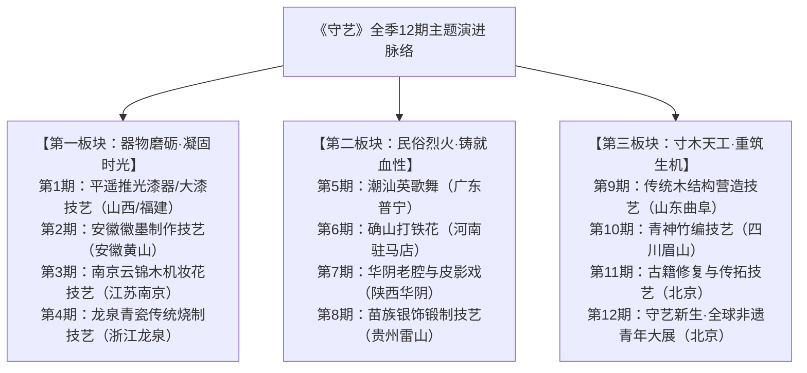
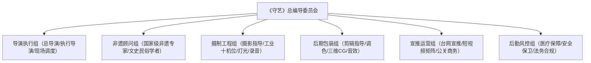

# 《守艺——大型青年非遗沉浸研学体验真人秀》策划案

---

## 一、节目核心信息概览

### （一）节目名称与命名内涵
- **节目名称**：《守艺》
- **命名内涵**：
  “守”者，坚守、守护、守心也；“艺”者，手艺、道艺、中华文脉也。《守艺》立足2024年非遗从“线上走红”向“线下生根”转型的关键节点，直击当下非遗保护“流量喧嚣但技艺断层、大众爱看但学徒寥寥”的现实痛点。“守艺”不仅代表着老一辈匠人于喧嚣尘世中择一事终一生的苦守，更寓意着呼唤青年一代走进原生作坊，以心火接续微光，让古老非遗在沉浸式研习中真正“守得住、传得开、活得长”。

### （二）节目口号（Slogan）
> **“一事一念守寸心，择一技以度韶华。”**

### （三）节目类别
- **题材外壳**：国家级非物质文化遗产传承与保护
- **驱动机制**：青年沉浸式学徒实操 + 真实挫折纪实 + 现代生活美学创变
- **形态属性**：大型青年非遗沉浸研学体验真人秀

### （四）节目体量
- **季播期数**：单季共 **12期**（量词严格规范用“期”）
- **单期时长**：**90分钟**

### （五）播出平台与编排时段
- **电视端（首播平台）**：一线卫视（如浙江卫视 / 江苏卫视）每周五晚间黄金档 **20:30—22:00**（首播）。
- **电视端（重播安排）**：次日（周六）午间 **14:00—15:30**。
- **网络端（独播与分发）**：头部视频网站（如腾讯视频 / 芒果TV）每周五晚 **21:00** 全网独播，同步上线 **4K超高清纯享版** 与 **非遗慢直播工坊通道**。

### （六）受众画像与分层定位
1. **核心受众（18—35岁青年群体）**：
   - **群体构成**：高校大学生、初入职场的都市青年、新中式国潮文化爱好者、传统手工艺与非遗关注者。
   - **心理痛点**：身处快节奏与内卷环境中，普遍存在精神焦虑与生活浮躁感，渴望寻找能够安顿内心的精神锚点；对非遗文化有强烈的民族自豪感与审美认同，但深感传统技艺门槛高不可攀，缺乏深入学艺的真实触点。
   - **定位动因**：通过青年视角的真实“学徒之旅”，拉近古老非遗与年轻人的心理距离，提供情绪解压与匠心疗愈。
2. **辐射受众（36—55岁大众与家庭受众）**：
   - **群体构成**：重视子女文化教育与家风传承的中青年家长、文博爱好者、文旅出行群体。
   - **心理诉求**：注重节目的文化品位、知识增量与代际精神传承，期待看到能够全家共赏、兼具思想性与艺术性的文化清流之作。

---

## 二、节目背景与策划动因

### （一）政策引领与国家战略背景
党中央高度重视非物质文化遗产保护传承工作。中共中央办公厅、国务院办公厅印发《关于进一步加强非物质文化遗产保护工作的意见》，明确提出要“坚持创造性转化、创新性发展，使非物质文化遗产更好融入现代生活、体现当代价值”，并鼓励引导青年人参与非遗传承。国家广播电视总局亦多次强调文化文艺节目要“坚持以人民为中心的创作导向，抵制泛娱乐化，以深厚文化底蕴涵养视听文艺”。

### （二）时代节点与市场现实痛点
2024年，中国“非遗”保护迎来前所未有的繁荣景象：
1. **现象级传播破圈**：春节期间，潮汕英歌舞以阳刚豪迈的气势燃爆全网，全网视频播放量突破数亿次；李子柒复出后首条视频聚焦古老深邃的“大漆技艺”，让深闺中繁复的大漆工艺引发全球叹服；
2. **平台生态赋能**：头部短视频平台发起“非遗合伙人”计划，助力数千名非遗传承人开设账号，数字化传播让非遗从地方走向大众视野。

然而，“烈火烹油”的热闹背后，暗藏着非遗传承的**结构性隐忧**：
- **“人走技失”的现实困境**：大量老手艺人年事已高，青年学徒青黄不接。社会大众对非遗“点赞多、买单少，围观多、学艺少”。
- **综艺市场的同质化沉疴**：当前荧屏同类文化节目多停留在“明星走马观花走秀”、“快餐式打卡摆拍”或“演播室答题煽情”，鲜有沉入作坊深处、直面手艺学徒之苦、解决真实传承断层的扎实作品。

### （三）承上启下立项句
**鉴于此，一线卫视联合头部网络视听平台，拟于2025年第二季度倾力推出大型青年非遗沉浸研学体验真人秀《守艺》，旨在以沉浸式学徒体验打破非遗传承困境，让古老技艺在青年血液中生生不息。**

---

## 三、节目宗旨与核心立意

### （一）节目宗旨与价值导向
坚守广电文艺政策底色，**社会效益优先，坚决抵制唯流量论与泛娱乐化浮夸风**。不搞剧本摆拍，不搞低俗噱头，真实展现非遗技艺背后所凝聚的民族智慧与精神骨气；不仅要展示非遗之美，更要直击“学徒生计”、“技艺传承”与“现代造血”等严肃现实课题。

### （二）文化内涵与精神赋能
1. **守艺即守心**：在浮躁时代重塑“慢下来、沉下去、磨出来”的工匠精神，为当代年轻人提供对冲焦虑的心灵处方；
2. **两创激活生机**：搭建传统技艺与现代生活美学的桥梁，推动非遗从“陈列馆的标本”化为“青年人身边的日用”。

---

## 四、节目核心特色与创新维度

### （一）核心模式机制创新：独创“三阶真学徒进阶制”
彻底摒弃“一日游”体验，确立**“拜师入道 $\rightarrow$ 枯燥磨砺 $\rightarrow$ 青春新创”**的真学徒进阶闭环：
- **第一阶·识材敬祖（知其然）**：上山采料、寻访原产地，认知自然造物的严苛法则；
- **第二阶·千锤百炼（知其苦）**：闭门研习，直面手起血泡、大漆过敏、反复报废的学艺阵痛；
- **第三阶·创变新生（知其用）**：打破“老气”标签，将传统非遗工艺与现代工业设计、青年审美跨界融合，打造实用美物。

### （二）内容叙事语态升级：去滤镜化的“纪实微观察”
不粉饰太平，镜头对准非遗作坊中斑驳的案台、磨损的双刀、手艺人粗糙干裂的手掌；全程真实记录常驻嘉宾在学艺过程中的退缩、崩溃、死磕到顿悟，以真实的情感张力引发代际共鸣。

### （三）高新视听技术赋能：工业级微距与时空重构
- **超微距与高速升格**：使用探针镜头深入大漆推光微观颗粒、铁花绽放、金丝穿引的毫厘细节，展现“肉眼不可见的极致匠心”；
- **XR扩展现实**：在展示非遗历史脉络时，利用XR技术让古代典籍壁画中的造物场景跨时空复活。

### （四）星素结合机制设计（严格契合广电合规）
- **明星降维做学徒**：演艺嘉宾卸下光环，严格遵守传统门规，端茶倒水、清扫作坊、按部就班研磨基本功；
- **素人大师为主体**：国家级代表性传承人担纲“山门严师”，决定学徒能否出关；青年守艺二代担任“同门师兄/姐”，展现最真实的代际坚守与碰撞。

---

## 五、角色设置与核心阵容配置

### （一）常驻“青年守艺研学团”（4人，性格互补、德艺兼备）
1. **沉稳专注型·青年演员 A**：
   - *角色定位*：研学团班长，动手能力极强，耐得住性子，沉稳踏实，负责协调团队与攻坚高难度实操。
2. **国风审美型·青年音乐人 B**：
   - *角色定位*：对传统声韵与东方审美感知敏锐，负责探索非遗韵律与当代艺术表达的灵感跨界。
3. **设计灵巧型·青年手作/美院UP主 C**：
   - *角色定位*：具备深厚造型功底与工业设计思维，连接传统工艺与当代潮玩、家居的创意转化者。
4. **坚韧热血型·青年运动员/舞者 D**：
   - *角色定位*：体能充沛、不怕吃苦受累，面对体力密集型工序（如英歌舞武术、龙泉锻剑、打铁花）冲锋在前。

### （二）素人主角群（非遗大师与传人矩阵）
- **掌门严师**：国家级非物质文化遗产代表性传承人（每期1~2位），代表行业最高技艺水准与精神风骨。
- **守艺青年**：非遗家族新生代传人或民间返乡学艺青年，分享“坚守清贫与面对现实”的人生故事。

### （三）文化学者与行业观察团
- 邀请中国艺术研究院学者、故宫博物院文物修复专家、知名设计策展人组成“守艺观察席”，在展演评议环节进行专业评析。

### （四）节目主理人（持证专业主持人）
- 由总台或一线卫视具备深厚人文底蕴的持证专业主持人担纲，掌控全场节奏，不介入任务竞争，专注深度访谈、价值观提炼与串联推进。

---

## 六、核心任务规则与赛制机制

### （一）规定情境与初始目标设定
- **规定情境**：研学团必须在每站非遗原生工坊或古村落集中闭关 **7天6夜**，全程收缴电子设备，与传承人同吃同住同劳作。
- **初始目标**：全团必须合力完成一件符合国家级工艺标准的**“出山守艺结业大作”**，若未通过大师及观察团联合盲审，将无法获得本站守艺印鉴。

### （二）推进规则：“匠心三炼”考核机制
1. **一炼·材之初（原料甄选考核）**：
   - 深入深山或矿脉，按照古法甄选严苛原料，掌握辨材识料的硬功夫；
2. **二炼·工之极（工序复刻考核）**：
   - 规定时间内完成一门非遗最枯燥核心工序的“千次肌肉记忆训练”（如推光千次、运槌千次、调浆百次）；
3. **三炼·用之美（现代共创考核）**：
   - 结合青年日常实用场景进行器物革新，作品必须具备当代审美与实际使用功能。

### （三）长效造血激励机制（杜绝恶俗胜负炒作）
- **不设明星淘汰晋级**：以“守艺星火池”累积研学积分；
- **产业长尾赋能**：每期成功通过考核的共创作品，将由节目组联合中国乡村发展基金会及短视频平台“非遗合伙人基金”，全资资助当地建立“青年非遗传习工坊”，提供定向学徒生活补贴，让非遗真正具备自我造血机能。

---

## 七、整体季播脉络与单期全流程执行方案

### （一）全季12期主题演进地图

---

### （二）典型单期全流程执行方案：第一期《漆彩华光·淬炼初心》
- **本期非遗主题**：大漆髹饰技艺与推光漆器（呼应李子柒大漆视频社会热点）
- **录制地点**：平遥古城国家级非物质文化遗产推光漆器传习基地及太行山深处生漆林场
- **单期时长**：90分钟

#### 1. 第一阶段：山门启封·初试漆锋（约15分钟）
- **情境与动线**：研学团4人清晨抵达古朴典雅的平遥漆器作坊。国家级非遗传承人端坐堂前，四位青年行古法奉茶拜师礼。
- **任务发布**：主理人开启暗盒，出示一尊历经百年依然温润如初的大漆剔红花瓶，发布本站终极目标——“在7天内合力推制并髹饰出一套‘东方大漆茶席套组’，通过百次水磨与掌心推光，映照出人影方为合格”。
- **下马威考核**：大师递给每人一块木胎与生漆，要求分辨生漆与化学腰果漆的区别，嘉宾在辨析与触碰中首次感知大漆的独特气味与威力。

#### 2. 第二阶段：割漆之苦·漆毒试炼（约35分钟）
- **外景拉练**：跟随老割漆人跋涉进太行山密林，亲身体验“百里千刀一斤漆”的艰辛。在凌晨露水未干时攀爬古漆树，使用蚌壳斜割漆口，体会一滴纯正天然大漆的来之不易。
- **现实困境与挫折**：返回作坊实操调灰打底时，成员C与成员D因皮肤敏感突发严重“大漆过敏”，面部发痒红肿。作坊老匠人拿出生姜水与秘方药膏悉心照料，道出行业铁律：“不被漆咬，成不了漆匠；过敏不仅是折磨，是大漆在认它的主人。”
- **心理蜕变**：成员们在挫折中克服恐惧，重新穿戴防护围裙重回工台，开始漫长枯燥的木胎刮灰、打磨工序。

#### 3. 第三阶段：枯燥水磨·掌心生温（约25分钟）
- **攻坚环节**：制作推进至最关键的“水磨与推光”。将细砂纸换为古瓦灰与麻油，直接以人手手掌作为打磨工具。
- **纪实冲突**：成员A因急躁用力过猛导致漆层磨穿露出木胎，整件作品面临报废风险，工坊气氛骤降冰点。青年传承人师兄耐心开导，讲述自己当年学艺磨穿数十个胎底的迷茫往事。
- **匠心凝聚**：全员静下心来，围坐水盆旁，在流水潺潺中一圈圈推磨，从晨光初破磨到更深夜静，直至手掌发热发烫，漆面逐渐退去浮躁贼光，现出深邃内敛的温润宝光。

#### 4. 第四阶段：守艺大赏·代际围炉（约15分钟）
- **成果检验**：作坊中堂灯火通明，四件茶席套组静卧案头。大师手持烛火靠近漆面——烛光跳动，人影清晰倒映在漆面之上！大师郑重颔首，盖下朱红认可印鉴。
- **围炉夜话**：主理人、研学团与大师祖孙三代围坐古槐树下，品茗对谈，深入探讨“年轻人到底如何看待大漆的慢与贵”、“如何让大漆器物重新走入寻常百姓家”。
- **主旨升华**：主理人发表结语，定格四人沾满生漆但目光坚毅的双手特写，引出下期预告。

---

## 八、主持人 / 主理人串词设计与核心台词示范

### （一）开篇先声夺人串词（设疑引入·破冰入题·任务发布）
- **场景与镜头**：晨曦破晓，晨雾弥漫在平遥古城青灰色的屋脊之上。主理人一袭素雅棉麻长衫，缓步穿过漆器作坊古老的雕花门楼，镜头由全景缓缓推进至主理人特写，周围回荡着有节奏的砂纸打磨声。
- **主理人台词**：
  > “【主理人神色宁静，向镜头微微颔首，目光坚定而温和】
  > 
  > 各位观众朋友，欢迎来到由XX平台为您呈现的大型青年非遗沉浸研学体验真人秀——《守艺》。
  > 
  > 前些日子，李子柒带着大漆重回大众视野，无数人在惊叹‘漆黑如夜、温润如玉’的同时，也第一次知道了一句话——‘百里千刀一斤漆’。
  > 
  > 可是，当喧嚣的热搜散去，镜头之外的泥土作坊里，又有多少人知道，一滴真正的大漆，需要漆农在绝壁密林里守候整整一夜？一件传世的漆器，需要匠人在暗室里经过成百上千次的研磨推光？
  > 
  > 今天，我们四位习惯了手机键盘与快节奏生活的年轻探寻者，告别城市的繁华，来到这座千年古城。等待他们的，不是轻巧惬意的打卡采风，而是一场关于忍耐、蜕变与敬畏的心灵试炼。
  > 
  > 【转身引向作坊内堂，语调高亢激昂】
  > 
  > 守艺之旅，今日启程！让我们随他们一起，推开这扇封存时光的古老山门！”

---

### （二）推进转场与规则解说串词（串联剧情·悬念推进）
- **场景与节点**：作坊打磨区，两名嘉宾刚经历了大漆过敏的红肿煎熬，面对案台上层层叠叠的半成品木胎，神情疲惫且沮丧。主理人缓步走到工台旁，递上两碗温热的生姜水。
- **主理人台词**：
  > “【主理人关切地注视着青年嘉宾泛红的双手，语气充满理解但依然坚定】
  > 
  > 疼吗？痒吗？我想每一个第一次接触大漆的人，身体都会发出最真实的抗议。但刚才老掌门对我说了一句话，他说：‘漆抓人，那是大漆在认主。’
  > 
  > 真正的传统从不轻易接纳浮皮潦草的过客。现在摆在大家面前的，是平遥推光最残酷的一道工序——‘手掌推光’。
  > 
  > 在接下来的整整六个小时里，没有任何机械可以代替，你们只能用自己带有体温的手掌，蘸着特制的细瓦灰与麻油，在漆面上推磨至少三万次！
  > 
  > 考核的标准只有一条——熄灭顶灯，点燃案头的蜡烛。如果漆器表面不能像明镜一样清晰映照出你脸上的纹理，今天的研学印章，将无法盖下。
  > 
  > 年轻的守艺人们，时间在流逝，掌心热起来，奇迹才会发生。准备好了吗？开工！”

---

### （三）深度对谈/交锋引导串词（大师对谈·递进式灵魂发问）
- **场景与节点**：深夜工坊中庭，老榆木茶桌上烛光摇曳。主理人与国家级传承人薛老先生、青年研学嘉宾围坐品茗，直面非遗的生存与代际传承困境。
- **提问引导①（直击清贫与坚守之痛）**：
  > “薛老，今天孩子们推了一下午，手掌全磨秃了皮。我听大师兄说，这门手艺您在这间屋子里坐了整整六十年。在年轻人都涌向大城市挣快钱的今天，您当年有没有哪怕一个瞬间，觉得守着这堆漆木头，过得太苦、太寂寞了？”
- **提问引导②（直面‘人走技失’的现实危机）**：
  > “现在很多年轻人网上看视频，觉得非遗酷极了、太美了；可真要招学徒，三年不开张，工资甚至不如去送外卖。面对这种‘网上叫好、门前冷落’的现实落差，您觉得我们究竟该拿什么留住年轻人？”
- **提问引导③（探讨传统与现代共生的解法）**：
  > “刚才我们年轻的设计师提出来，想用大漆做赛博朋克风格的电脑机箱和手机壳，老一辈人可能觉得丢了规矩。在您看来，非遗的‘根’究竟是那些古老的器物形状，还是那股代代相传的精气神？”
- **主理人归纳升华词**：
  > “【主理人动情地望向漆案上反射着月光的茶具，语调温润深沉】
  > 
  > 听了薛老的话，我忽然明白了一件事。我们总以为是非遗在等待年轻人去拯救，其实恰恰相反——是这些历经千百年的手艺，在抚平这个浮躁时代留给年轻人的创伤。
  > 
  > 所谓守艺，守的从来不仅仅是泥土木石，守的是一辈辈中国人在岁月长河中，不被虚名所累、不为疾风所动的那份从容与定力。”

---

### （四）单期结语升华金句串词（情境留白·主旨拔高·下期预告）
- **场景与镜头**：古城夜深，星河浩瀚。四位年轻人的手掌虽然沾满洗不掉的深褐色漆渍，但每个人的脸上都洋溢着澄澈从容的笑容。镜头缓缓拉远，从古朴庭院升至高空，将整座平遥古城的灯火尽收眼底。
- **主理人台词**：
  > “【配乐渐起，低沉大提琴与悠扬竹笛交织，主理人深情总结】
  > 
  > 一勺生漆，经百转千回的磨砺，终见灼灼华光；
  > 一颗寸心，历日复一日的守候，方知岁月悠长。
  > 
  > 2024年的热搜见证了非遗破土而出的力量，而今夜平遥古城这盏不灭的烛火，则见证了一群中国年轻人接续文脉的坚实脚印。
  > 
  > 人走了，技艺不会失传，只要还有人愿意俯下身子，抚摸古人的温度。
  > 
  > 感谢收看本期《守艺》。下一期，我们将一路向南，奔赴潮汕大地。在震天动地的锣鼓与呼号中，看那群平均年龄不到二十岁的少年，如何用双槌舞出独属于中华男儿的滔天血性！
  > 
  > 守寸心，度韶华。观众朋友们，下周五晚同一时间，我们江湖再见！”

---

## 九、摄制策略与工业级工程技术规范

### （一）外景舞美与实景工坊规划
- **实景沉浸改造原则**：拒绝在千篇一律的无机质演播室内录制，100%深入非遗原生产区；在平遥古民居四合院内保留原汁原味的工台、石碾、古灶与木架，仅在视听层面进行隐藏式管线与声画优化。
- **开放式评析展台**：在工坊中庭天井处设置简约通透的“四水归堂”鉴赏台，背景衬以素纱与青砖，营造“人在画中磨，光在器上生”的东方禅意美学。

### （二）灯光系统与色彩美学
- **自然主光与暖调补光结合**：日间拍摄以自然天光为主，辅以4000K色温轻型柔光屏（如Aputure 600d）对嘉宾面部进行漫反射柔化，展现真实的劳作肤色。
- **器物高显色特写系统**：在器物打磨台上方布设定制高显色指数（CRI $\ge$ 98、TLCI $\ge$ 98）微型聚光灯，精准控制反光角度，展现大漆不同抛光阶段的折射光斑与细腻肌理。
- **色彩影调基调**：全片采用电影级色彩风格，色调厚重内敛，阴影区偏向青黛灰，高光区偏向象牙暖黄，强化历史积淀感。

### （三）工业级十机位调度规范参数表

| 机位编号 | 物理位置与设备选型 | 景别与运镜方式 | 核心拍摄功能与画面任务 |
|:---:|:---|:---|:---|
| **1号机位** | 中央主机位（中景索尼FX9/佳能C500 II） | 中景、近景，平视慢推 | 锁定主理人正面调度、大师指导正向视线与主任务发布 |
| **2号机位** | 正后方全景机位（4K电影机配广角） | 大全景、远景，固定锁定 | 交代作坊四合院完整空间格局、整体采光氛围与全员劳动态势 |
| **3号机位** | 侧向副主机位（85mm/135mm定焦镜头） | 特写、大特写，浅景深 | 捕捉嘉宾在挫折、疲惫、顿悟时的面部微表情与眼神细微颤动 |
| **4号机位** | 舞台侧翼游动轨道机位（遥控电控滑轨） | 全景平移、慢速推拉 | 交代工坊纵深透视关系，营造舒缓沉静的纪实电影质感 |
| **5号机位** | 观察席/学者席机位（70-200mm变焦） | 中景、特写，反应镜头 | 抓取文化学者、大师家人在侧观摩时的赞许、叹息等即时情绪反馈 |
| **6号机位** | 学徒反打机位（偏角45度） | 中景双人构图、正反打 | 记录师徒之间的动作纠偏、眼神对视与代际言传身教 |
| **7号机位** | Steadicam穿戴式稳定器游机（随身跟拍） | 移动跟拍、主观视角（POV） | 穿梭于工坊各工位与后厨、后院之间，抓取突发走动与自然交互 |
| **8号机位** | 超微距探针特写机位（老蛙24mm探针镜头） | 微观极端特写、极慢平移 | 深入大漆液体滴落、瓦灰研磨微粒、掌心纹理接触漆面的微观奇观 |
| **9号机位** | 手持超轻量纪实微单（索尼A7S3高感光） | 贴身晃动纪实、低角度仰拍 | 随身捕捉嘉宾私下擦汗、包扎伤口、相互鼓励的真实碎片细节 |
| **10号机位** | 4K无人机航拍 / 电控摇臂 | 大鸟瞰、旋转俯冲、升降大景 | 交代太行山漆树林、古城晨昏全景与自然山川的壮阔时空背景 |

### （四）后期剪辑与花字视听包装
- **动态工艺三维剖析（CG动画）**：遇到专业术语（如“退光”、“揩清”、“百宝嵌”），画面适时定格，接入白描国风线稿微动效三维透视动画，以通俗视听语言拆解古法原理。
- **极简花字与克制配乐**：摒弃吵闹的综艺罐头笑声与花哨弹幕花字，采用宋体烫金微动效标注时间、工序进度；配乐以古琴、尺八、古筝及环境同期声（水声、研磨声、喘息声）为主。

---

## 十、全生命周期宣传推广策略

### （一）播前蓄水期（打透“反差”与“真苦”，打破偶像滤镜）
1. **反差物料定档官宣**：
   - 发布《这届年轻人，被漆咬肿了脸》先导纪实短片，全网释放明星嘉宾沾满泥灰、手上贴满创可贴、素颜疲惫但眼神坚毅的实拍物料，击碎传统综艺“明星享乐摆拍”的公众预期。
2. **“寻访民间守艺人”全网建档**：
   - 联合微博、快手、抖音发起话题 `#谁在守护你的家乡非遗#`，征集全国濒危手艺故事，精选内容作为每期片尾“致敬彩蛋”。
3. **沉浸式ASMR慢音预热**：
   - 在网易云音乐、QQ音乐上线“非遗白噪音专辑”（大漆推光声、锻铁撞击声、织机穿梭声），提供当代青年专属助眠音效。

### （二）播中爆发期（台网跨屏共振 + 短视频平台“非遗合伙人”深度闭环）
1. **深度联动短视频平台“非遗合伙人”生态**：
   - **一期一主理**：每期节目播出当晚，节目中出镜的非遗传承人与青年学徒同步入驻合作短视频平台“非遗合伙人”官方专区，平台给予百亿流量扶持与优质创作者认证；
   - **大V二创联盟**：邀请手工耿、才疏学浅的才浅等顶流手作UP主及泛文化头部博主作为“云端学徒”，每期同步发起同题材工艺复刻挑战。
2. **切片微传播裂变矩阵**：
   - 将每期节目剪辑为三个层次的短视频切片：
     - *情绪共鸣向*（30秒）：如老掌门说出“守艺守的是骨气”等高燃金句；
     - *微观奇观向*（45秒）：1000帧升格下的漆器反光、铁花飞溅绝美瞬间；
     - *技能干货向*（60秒）：手把手教年轻人辨别真正传统工艺的防坑小常识。
3. **社会议题破圈造势**：
   - 每周五晚联合微博、知乎打造深度社会热搜：
     - `#为什么年轻人只爱看非遗不爱学非遗#`
     - `#非遗传人一个月到底能挣多少钱#`
     - `#李子柒带火的大漆究竟有多难做#`
   - 引发文化界、社会学学者与广大网民的深度讨论，推动节目从“娱乐场”迈向“公共议题广场”。

### （三）播后发酵与长效转化期（从“一次收视”走向“终身留存”）
1. **全国青年非遗文创巡展**：
   - 整季结束后，联合中国美术馆、国家图书馆举办“《守艺》青年造物成果大展”，展出全季嘉宾与大师共创的12组器物，门票收益全部注入青年非遗基金。
2. **“跟着《守艺》去打卡”文旅线路落地**：
   - 联合文旅部门推出平遥古法漆艺研学游、潮汕英歌舞实景体验营等精品文旅线路，把节目流量直接转化为地方非遗村落的造血实体经济。
3. **高校“守艺传习社”落地计划**：
   - 联合全国八大美院及综合类大学文博学院，由节目组出资赞助成立高校非遗青年工坊，让节目在校园青年中真正长出根系。

---

## 十一、商业植入与产业衍生闭环

### （一）品牌赞助合作原则（严选国货底色）
- **独家冠名**：甄选兼具民族自豪感与工匠精神的国货汽车品牌或高端新中式茶饮/护肤品牌（如红旗汽车 / 观夏 / 东阿阿胶），Slogan深度融合（如：“以匠心，守初心”）。
- **场景化软植入**：拒绝粗暴生硬的口播打断；品牌产品仅作为嘉宾劳作间隙的解乏饮品或转场座驾，深度融入真实生活场景。

### （二）文创衍生与“新造物”长效电商闭环
- 依托短视频平台“非遗电商橱窗”，开通《守艺》官方正品优选店铺，独家发售由非遗大师监制、青年研学团联名设计的限量版文创日用品（如大漆书签、英歌舞手办盲盒、龙泉青瓷主人杯），所有销售分成向非遗手艺人倾斜，彻底打破“手艺人守着金山要饭吃”的困局。

---

## 十二、组织架构编制与经费预算

### （一）团队组织分工架构表

### （二）单季制作经费预算明细清单（基准：2300万元）

| 预算科目 | 包含具体明细内容 | 预估金额（万元） | 占比（%） |
|:---|:---|:---:|:---:|
| **一、场地租赁与置景工程** | 12处非遗作坊实景租用、中庭展台改造、水磨工坊安全改造 | 320 | 13.9% |
| **二、演职人员劳务报酬** | 主理人劳务、4位常驻青年嘉宾、12站非遗大师及传人课酬（大师课酬予以倾斜） | 680 | 29.6% |
| **三、摄制设备与工程技术** | 4K电影机、工业十机位全套租赁、微距探针镜头、电影灯光组、航拍与滑轨 | 380 | 16.5% |
| **四、非遗原材料与损耗** | 天然生漆、优质徽墨松烟、云锦金线、龙泉紫金土等昂贵非遗耗材及试错损耗 | 180 | 7.8% |
| **五、后期制作与视听包装** | 粗精剪辑、电影级DI调色、三维原理解构CG特效、原创配乐交响录制 | 260 | 11.3% |
| **六、全媒体宣传推广与营销** | 户外大屏、主流热搜公关、短视频大V采买、播后国家级大展策展 | 350 | 15.2% |
| **七、医疗安保与机动备用金** | 大漆过敏等医疗急救绿色通道、外景意外险、法务审核、不可预见杂费 | 130 | 5.7% |
| **合计** | **整季12期总投资预算** | **2300** | **100%** |

---

## 十三、广电政策合规与应急保障预案

### （一）国家广电总局政策红线合规审查
1. **严格贯彻落实广电办发〔2021〕267号文**：
   - 严把演职人员政治关、道德关与艺术关，坚决杜绝违法失德艺人出镜；
   - 彻底破除唯流量论，杜绝资本操控打榜、严禁引导“饭圈”控评集资；
   - 坚决杜绝泛娱乐化倾向，严禁恶俗整蛊、恶意炒作嘉宾矛盾，全片格调昂扬健康。
2. **规范演职人员资质**：
   - 节目主理人严格落实“持证上岗”制度，非持证嘉宾仅以“学徒/探访者”身份参与，绝不使用“嘉宾主持”名义。

### （二）非遗实操安全与医疗应急预案
- **生漆与高温作业专项预案**：针对大漆过敏、铁花烫伤、陶瓷窑炉高温等潜在危险，随队配备专职皮肤科与烧伤科随行医生，进驻前全员进行过敏源脱敏测试，备足抗过敏药物与专业防护装备。

### （三）舆情监测与应急公关机制
- 建立全网7×24小时舆情监控雷达，针对非遗技艺历史沿革争议、地域文化解读细微差别等敏感点，由非遗专家顾问组实行“前置双审制”，确保每一句解说词、每一个工序名词均经得起学术考证。
