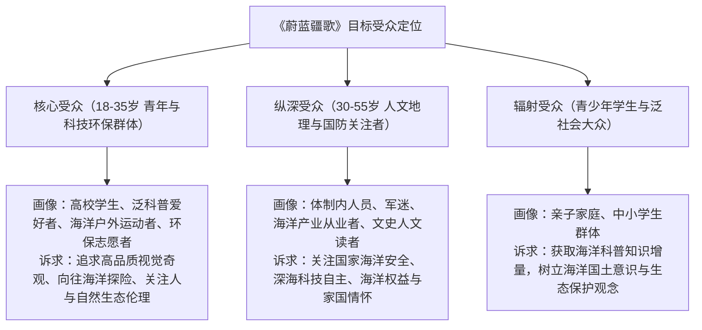
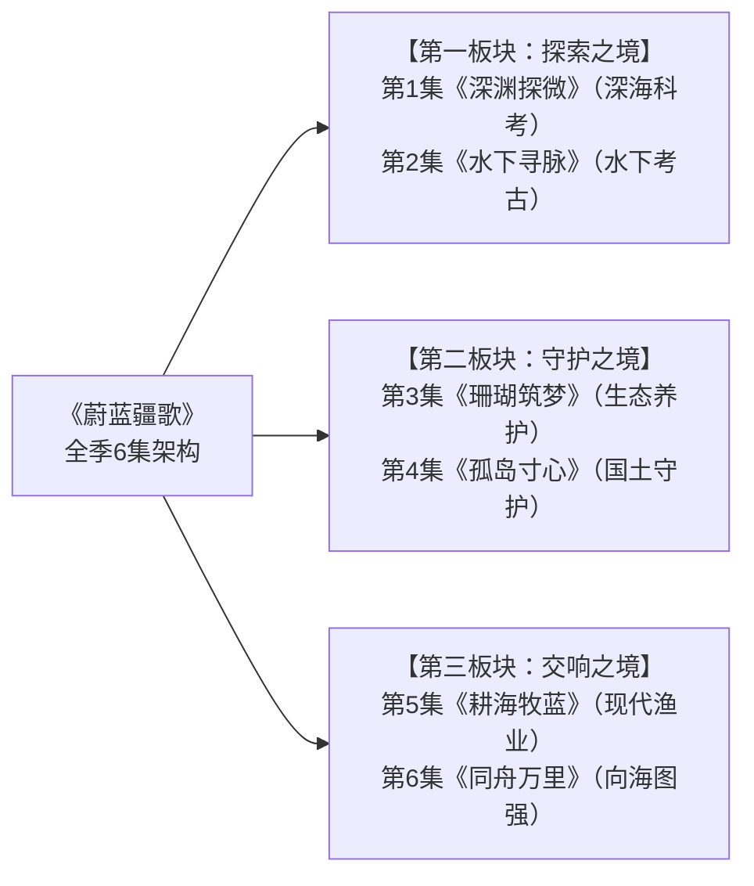
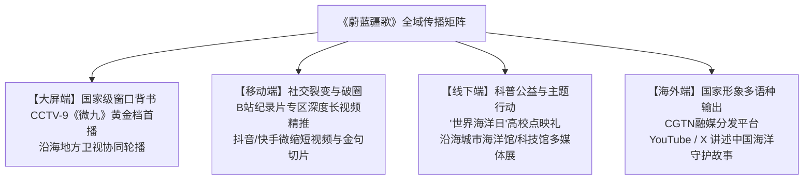
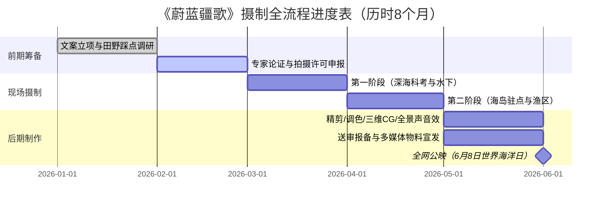

# 《蔚蓝疆歌》——大型海洋人文纪实系列短片策划案

---

## 一、项目核心信息概览

### （一）片名与命名内涵
* **短片片名**：《蔚蓝疆歌》
* **命名内涵**：
  * **“蔚蓝”**：指代我国300余万平方公里的辽阔主权管辖海域与1.8万公里的大陆海岸线，既代表广袤纯粹的海洋生态本色，也象征通向未来的蓝色战略空间。
  * **“疆”**：寓意“蓝色国土”与“探索边疆”。我国海洋不仅是自然地理意义上的蓝色家园，更是国家主权不可分割的领土边疆、科技攻坚的深海极限边疆。
  * **“歌”**：取意“时代长歌、人文颂歌”。短片聚焦碧海之间平凡而伟大的奋斗者，以纪实镜头为琴弦，谱写一曲人与海洋和谐共生、向海图强的时代交响。

### （二）节目口号（Slogan）
> **“沧海何茫茫，寸心守蔚蓝。”**  
> *(备选：“向海而行，且听碧海万里长歌。”)*

### （三）题材与形态定位
* **题材属性**：海洋生态文明与海洋强国战略人文纪实
* **形态属性**：大型4K超高清人文纪实系列短片（微纪录片）
* **叙事机制**：微观人物田野纪实 + 电影级深海微距视听 + 口述史与当下行动互文

### （四）体量与规格规划
* **系列规模**：全季共 **6集**（以短片形态精炼呈现，独立成章又内在统一）
* **单集时长**：**10分钟 / 集**（契合微纪录片黄金体量，兼顾大屏深度叙事与移动端轻量传播）
* **技术制式**：4K 50P HDR高动态范围呈现，全景声（Dolby Atmos）声场采集与制作

### （五）排播平台与档期规划
* **大屏端（首播平台）**：中央广播电视总台纪录频道（CCTV-9）黄金档 **19:50—20:00**（《微九》时段）首播；沿海省份卫视（如广东卫视、浙江卫视、山东卫视）联合展播。
* **网络端（独播与分发）**：央视频、腾讯视频、Bilibili于首播日 **20:00** 同步上线超高清纯享版与幕后特辑。
* **排播档期**：定档于 **6月8日“世界海洋日暨全国海洋宣传日”** 启动全网展播，连更6天，形成爆发式传播合力。

### （六）受众画像与分层定位

---

## 二、策划背景与立项动因

### （一）宏观国家战略与政策引领
党的二十大报告明确提出“发展海洋经济，保护海洋生态环境，加快建设海洋强国”。海洋是高质量发展的战略要地，建设海洋强国是实现中华民族伟大复兴的重大战略任务。国家广电总局亦多次要求纪录片创作要“扎根中国大地，讲好新时代中国故事，生动呈现生态文明建设与科技自立自强的壮阔实践”。

### （二）时代节点与社会心理洞察
1. **公众海洋意识的跃升与拓展**：从古代海上丝绸之路的历史回响，到“奋斗者”号探索万米深蓝，中国人的海洋视野已由浅海走向全海深。公众不再满足于概念化的宣教，更加渴望近距离感受海洋的生命律动与前沿探索。
2. **人文视角与共情机制的渴求**：当下快节奏的生活中，大众对广袤蔚蓝充满浪漫向往，但对扎根孤岛、风浪颠簸、坚守极地深渊的守海人缺乏具象认知。通过“以小见大”的个体命运书写，能够激发全民血脉深处的海洋向心力与家国同构共鸣。
3. **主流视听语言的轻量化创新**：长篇纪录片往往面临网生代注意力分散的挑战。系列微纪实短片以其“快节奏、强情节、精画面、高情感浓度”的特质，成为融媒体时代沟通主流价值与年轻受众的最佳视听载体。

### （三）承上启下立项句
**鉴于此，中央广播电视总台联合自然资源部宣传教育中心及头部视频平台，拟于2026年第二季度倾力推出6集人文纪实系列短片《蔚蓝疆歌》，旨在以极致视听语态和微观个体叙事，为中国蓝色国土立传，为新时代守海人铸魂。**

---

## 三、创作理念与核心立意

### （一）指导思想与导向原则
严格坚守**“社会效益优先”**的导向原则，杜绝悬浮煽情与过度说教。将宏大的“海洋强国”国家叙事解构为一个个坚守者的日常呼吸，在真实呈现自然法则与艰辛现实的基础上，展现中国人与海相处的情感哲学与责任担当。

### （二）纪实“五化”黄金创作法则的全面践行
> **“在保证纪录片真实性的基石上：纪录片故事化 → 故事情节化 → 情节细节化 → 细节人物化 → 人物命运化”**

* **故事化**：每集不罗列枯燥学术数据，聚焦一个核心主题下的真实事件冲突（如极端海况下的深潜挑战、即将消亡的珊瑚礁抢救）。
* **情节化**：提炼真实生活中的戏剧弧光（准备—挫折—攻坚—释然），构建扣人心弦的叙事悬念。
* **细节化**：捕捉海风吹裂的手掌、水下呼吸器传来的沉重喘息、生锈灯塔转动的齿轮声等微观颗粒度。
* **人物化**：人物不作为“科技/政策的发言工具”，而还原其作为父亲、女儿、青年或老人的普通人喜怒哀乐。
* **命运化**：将个人的生命轨迹与海洋的变迁紧密绑定，呈现“一人守一海，一生敬蔚蓝”的崇高宿命感。

---

## 四、视听语态与形式风格

### （一）视听美学体系
1. **影像色调**：
   * **浅海与陆地**：采用通透自然的日光胶片色调，还原海风、礁石、盐碱地与渔民皮肤的粗粝质感；
   * **深海与科考**：采用高对比度、冷峻深邃的工业科技色调（Deep Indigo），凸显万米幽暗与耐压潜器灯光的交织碰撞。
2. **镜头语言**：
   * **“宏观大写意”**：利用电影级航拍呈现海岸线大开大合的壮美地貌，强调人置身于汪洋中的渺小与坚守；
   * **“微观超写实”**：利用特种防水超微距探针镜头，捕捉珊瑚幼虫水下着床、深海热液盲虾触角搏动等肉眼不可见的生命瞬间。

### （二）声画对位与听觉设计
* **环境同期声构建声场**：拒绝铺满煽情背景音乐，大量使用自然水听器（Hydrophone）收录的声音——抹香鲸声呐咔嗒声、深海冷泉气泡破裂声、浪涛撞击礁石的轰鸣。
* **原创器乐融汇**：以管弦交响乐为基底，融合古老的埙、箫、骨笛与潮州大锣鼓声响，凸显海上文明的千年厚重。

### （三）解说词撰写核心规范
* **辩证声画关系**：画面已有信息解说词不作赘述，留白给画面与环境音；解说词专注于提炼画面背后的心理动机与历史纵深。
* **客观代词与短句结构**：大量运用“这”、“这里”、“此刻”等指示代词与动词短句，营造“正在发生”的现场沉浸感。

---

## 五、全季分集规划与人物矩阵（6集全景图谱）

| 集数 | 分集片名 | 核心切入维度 | 主人公（小人物切入） | 叙事主线与核心冲突 | 视觉奇观与高光场景 |
|:---:|:---|:---|:---|:---|:---|
| **第1集** | **《深渊探微》** | 深海科技与极限认知 | 90后全海深载人潜水器副驾驶青年潜航员 | 克服海底幽闭与设备警报，下潜万米马里亚纳海沟搜寻深海极端生命样本 | 万米海底高压探照灯刺破亿年黑暗；海底沉积物取样瞬间微观记录 |
| **第2集** | **《水下寻脉》** | 海上丝绸之路历史文脉 | 国家南海水下考古队资深潜水考古队员 | 在西沙群岛深水区抢救发掘宋元时期沉船遗址，与海流风浪抢时间 | 潜水员在幽蓝海底拂去瓷器千年海沙；水密隔舱古船构建XR时空还原 |
| **第3集** | **《珊瑚筑梦》** | 海洋生态养护与修复 | 西沙珊瑚礁繁育“海底植树”科研团队领头人 | 面对海水升温导致珊瑚白化危机，在水下20米人工托架繁育千万株石珊瑚幼苗 | 水下夜间珊瑚虫集体排卵的“海底飞雪”；白化死寂礁盘重现五彩斑斓 |
| **第4集** | **《孤岛寸心》** | 蓝色国土守护与家国情怀 | 驻守南海无淡水无居民礁盘灯塔的守海老民兵夫妻 | 台风季来临前抢修灯塔透镜电源，忍受数月无法与陆地通话的极限孤独 | 暴风雨夜巨浪拍击孤岛灯塔；夕阳下海风中缓缓升起的五星红旗 |
| **第5集** | **《耕海牧蓝》** | 传统渔猎向现代牧场转型 | 从父辈木船出海到操作深远海智能养殖网箱的青年“新渔民” | 传统经验与数字化海洋水质监测算法的碰撞，抵抗寒潮保卫深海金枪鱼鱼群 | 深海养殖工船巨型钢构破浪前行；成千上万鱼群如银色风暴环形洄游 |
| **第6集** | **《同舟万里》** | 海洋命运共同体与时代信念 | 参与国际海事救援与公海浮标监测的极地科考船青年船长 | 执行公海跨境救援与海洋气象预警，传递中国参与全球海洋治理的担当 | 破冰船破开南极浮冰；全球海洋观测浮标在万顷碧波间点亮蓝色信号灯 |

---

## 六、典型单集深度策划样片（第4集《孤岛寸心》）

### （一）单集核心信息
* **分集标题**：《孤岛寸心》
* **拍摄地点**：海南省三沙市某远海无居民岛礁灯塔
* **本集人物**：
  * **林建海**（58岁，守塔长达26年的老民兵、全国模范守岛人）
  * **陈玉兰**（56岁，林建海妻子，陪伴随岛18年，负责水文观测记录与后勤）

### （二）三段式叙事脉络大纲
1. **【起·荒岛与齿轮（00:00—03:00）】**：
   * *情境*：远离大陆数百海里的孤礁，面积仅0.2平方公里。林建海每日攀爬180级铁梯检修灯塔。
   * *冲突悬念*：气象台发布14级台风黄色预警，补给船因风浪推迟两周，海岛淡水蓄水池见底，备用发电机轴承出现异响。
2. **【承·风浪与长守（03:00—07:00）】**：
   * *纪实跟拍*：狂风暴雨拍打窗棂，夫妻二人用防水帆布死死捆绑发电机。林建海冒着被巨浪卷走的危险，在湿滑的塔顶更换备用灯胆。
   * *人物弧光*：妻子翻出泛黄的日记本，记录着二十余年来岛上死掉的几百株小树苗，以及儿子从童年到成家缺席的每一个瞬间。坚守不是无情，而是为了航道上成千上万归航的渔民。
3. **【转/合·光耀沧海（07:00—10:00）】**：
   * *高光收束*：台风过境，夜幕降临，塔顶强光如期穿透海雾，照亮远方过往的国际商船与归港渔船。电台里传来渔民熟悉的问候同期声。晨曦微露，两人在灯塔平台整齐列队，海风呼啸中升起一面鲜艳的国旗。

### （三）采访提纲设计（深入挖掘内心世界）
> [!NOTE]
> 采访遵循“短、平、准、深”原则，记者不出镜，以聊天式引导同期声真情流露。

1. “林叔，这个岛走一圈只要七分钟，您在这里走了整整二十六年，最难熬的到底是什么？”
2. “陈姨，当年他在信里说‘岛上什么都有，就是缺个做饭的’，您上岛第一天看到这片荒礁，哭过没有？”
3. “狂风暴雨把窗户吹碎的那天晚上，您死死抱住那个发电机，心里脑子里闪过的是什么？”
4. “海面上走过的那些大轮船，他们知道这岛上住着你们俩吗？这盏灯对您来说到底算什么？”
5. “如果到了退休必须离开的那一天，您最舍不得带走的是什么，最想留下的又是什么？”

### （四）标准四栏分镜头台本（节选：02:15—03:30 高光段落）

| 镜号 | 景别/运镜 | 画面内容（动作与微表情） | 声音内容（解说词/同期声/音效） | 时长 |
|:---:|:---|:---|:---|:---:|
| **01** | 全景（航拍环绕俯冲） | 茫茫深蓝大洋中央，一座孤零零的苍白礁盘，灯塔如白色利剑直插天际，狂暴的白浪不断拍击礁石。 | 【音效】烈烈海风呼啸声、重浪撞击礁石的低沉轰鸣。 【解说】（沉稳低回）在这片被季风反复洗刷的海域，方圆百里，它是唯一的锚点。 | 8秒 |
| **02** | 特写（定焦跟拍） | 狭窄阴暗的灯塔内部旋转铁梯，一双穿着磨破胶鞋的脚一步步向上攀爬，鞋底与生锈铁板发出刺耳摩擦声。 | 【音效】急促沉重的呼吸声、铁鞋踏板摩擦声“吱呀——哐当”。 | 5秒 |
| **03** | 特写（自然光逆光） | 林建海额头挂满豆大汗珠，布满海盐结晶的脸庞沟壑纵横，眼神专注凝视着巨大的菲涅尔旋转透镜。 | 【解说】一百八十级台阶，每天四次。二十六年，他丈量了相当于五座珠穆朗玛峰的高度。 | 7秒 |
| **04** | 微距（特种探针） | 机械齿轮咬合转动，机油与海盐混合物在齿条间缓缓蠕动，镜头穿过水晶透镜，折射出耀眼的夕阳金光。 | 【同期声】（林建海独白）“海上没有路标。天一黑，这盏灯就是过路船的眼睛。眼要是瞎了，船就回不了家。” | 9秒 |
| **05** | 中景（手持纪实微晃） | 塔底厨房，妻子陈玉兰正用勺子极力舀起淡水桶底部最后一口清澈淡水，小心翼翼注入搪瓷杯，动作极度克制轻柔。 | 【音效】水滴落在铁盆的清脆回响“叮咚”。海风在窗框缝隙呜咽。 | 6秒 |
| **06** | 大特写（慢动作升格） | 一盆种植在废弃油漆桶里的绿萝，叶片泛黄，却倔强地吐出一抹嫩绿新芽。窗外乌云压顶，台风即将来临。 | 【解说】在没有泥土的礁盘上，活下来本身，就是一首唱给大海的歌。 | 8秒 |

### （五）解说词示范文案（片尾升华段落）
> “（空镜：晨光微熹，红日跃出苍茫海平线，金光洒满礁盘与灯塔）
> 
> 这是一座没有名字的礁石，也是三百万平方公里蓝色国土上的一方磐石。
> 
> 二十六年，海风吹白了青丝，浪涛磨平了礁石的棱角。他没有轰轰烈烈的誓言，只是把自己的呼吸，安放进灯塔每一次明灭的呼吸里。
> 
> （画外音：渔船汽笛长鸣，划破宁静海天）
> 
> 茫茫沧海，微光成炬。守护蔚蓝的疆土，从来不仅需要劈波斩浪的巨轮，更需要这样一抔泥土、一滴淡水、一生长守的寸心。
> 
> 歌声无形，早已融进这浩荡长风，化作这片海域最深沉的底色。”

---

## 七、摄制策略与工业化技术标准

### （一）特种摄影与专业器材配置
* **水下极端摄影系统**：RED V-RAPTOR 8K电影摄影机 + Gates定制全金属深海防水壳 + 特种潜水探针镜头（Laowa 24mm Macro Probe），满足深水低照度与微距拍摄。
* **深海搭载平台**：与“探索一号”、“深海勇士”号科考母船协同，挂载全海深高清4K耐压广角相机与深海补光矩阵（总流明超过10万）。
* **超轻量移动航拍**：DJI Inspire 3电影级无人机配双控系统，搭载8K全画幅禅思X9-Air云台相机，抗风等级达6级，确保海岛悬崖与船坞动态航拍稳定性。
* **陆地纪实主机**：Sony FX9 / FX6 电影机，配备广播级防抖系统与变焦镜头，适应海上颠簸船体上的手持跟拍。

### （二）水声与环境音全景声采集方案
* **水下水听器（Hydrophone）矩阵**：采用双通道超低噪自容式水听器，下潜至20-100米水层，高保真收录海洋哺乳动物声学信号与海流涌动声。
* **现场抗风微型拾音**：全部核心人物佩戴DPA微型全指向抗风噪领夹麦克风，外加高密度防风兔毛罩，克服海岛10级瞬时风噪干扰。

### （三）摄制编组与专业人员配置
* **总导演/总策划**（2人）：统筹全片导向、立意把控与全流程品控。
* **田野纪实分队**（共2组，每组4人）：含分集导演1人、执行摄影2人、录音师1人，负责长期驻岛、登船深入一线跟踪记录。
* **特种水下与科技摄影组**（3人）：具备CMAS水下三星摄影潜水员资质的高级摄影师与潜水安全员。
* **海洋科学/文史顾问团**（4人）：聘请自然资源部第一海洋研究所研究员、国家水下文化遗产保护中心考古专家提供全程学术背书。

---

## 八、融媒体全域传播与矩阵营销

### （一）“小切口·强情绪”移动端切片分发
* **短视频抓手**：提取“万米深渊第一视角”、“灯塔夫妻26年生活账单”、“水下给珊瑚接生”等高戏剧性内容，剪辑成15秒—60秒的竖屏精炼片段，在抖音、视频号、快手集中投放。
* **话题设置**：微博与抖音打造热搜话题：`#中国守海人的二十六年#`、`#在万米深海看到了什么#`、`#属于中国人的海洋浪漫#`。

### （二）线下跨界联动与生态公益
* **“认领一株蔚蓝珊瑚”云互动**：联合中华环境保护基金会与三沙珊瑚研究基地，观众在观看第3集时可通过扫描屏幕二维码参与“云认领珊瑚”，科研团队将在西沙海域种下编号珊瑚苗并定期推送生长图文。
* **全国海洋高校巡回展映**：走进中国海洋大学、厦门大学等涉海高校，举行主创与潜航员、守岛人面对面交流分享会。

---

## 九、组织实施与经费预算

### （一）全生命周期进度规划

### （二）经费预算明细表（总预算规模：180万元人民币）

| 预算支出大类 | 具体明细包含内容 | 金额（万元） | 占比（%） |
|:---|:---|:---:|:---:|
| **田野调研与差旅交通** | 前期踩点、科考船舱位费、登岛包船接驳、全队食宿 | 38.0 | 21.1% |
| **设备租赁与特种耗材** | 4K电影机组、水下防水壳、无人机航拍、水听器、潜水气瓶 | 42.0 | 23.3% |
| **主创人员劳务支出** | 导演、摄影师、水下潜水员、录音师、科学顾问劳务报酬 | 45.0 | 25.0% |
| **后期制作与技术包装** | 4K HDR电影级调色、三维CG古船复原、Dolby Atmos混音、原创音乐配乐 | 28.0 | 15.6% |
| **融媒宣发与物料制作** | 海报预告片制作、平台信息流推广、高校点映物料、公关通稿 | 15.0 | 8.3% |
| **不可预见费与特种保险** | 人员海上高额意外险、设备落水险、恶劣天气延期机动备用金 | 12.0 | 6.7% |
| **合计** | **标准全流程制作总包预算** | **180.0** | **100.0%** |

---

## 十、安全保障与应急控制预案

### （一）恶劣气象与海洋灾害应急（台风/大浪/海流）
* **气象联动机制**：与国家海洋环境预报中心建立每日数据直通通道，遇6级以上阵风或海浪波高超过2米时，严禁任何船只离港出海拍摄。
* **避风撤离预案**：驻岛拍摄组必须保留充沛的7天应急干粮、淡水及卫星电话；一旦接到超强台风预警，严格遵循当地海事局指令，至少提前48小时随公务补给船全员撤离回陆地。

### （二）深潜与特种水下作业安全规程
* **潜水“潜伴制度”与减压舱保障**：严禁单人下潜作业。所有水下拍摄团队必须由取得国家潜水执照的安全员一对一监护，下潜深度严格限制在安全潜水深度之内；随船常备高压氧气与便携急救设备。
* **防水安全与数据备份**：摄影机壳下潜前必须经过加压水密测试；每晚拍摄结束，素材立刻进行“两台移动固态硬盘 + 一台云端加密冷备份”的三重数据冗余归档。

### （三）涉密与涉外法务合规保障
* **国防与领海安全红线**：涉及三沙岛礁、海警执法巡航、军民共建场景的镜头素材，成片前严格送交海警与主管宣传部门进行内容脱敏审查，严禁泄露国防军工与主权水文保密坐标。
* **版权与肖像授权**：所有出镜守岛人、科研工作者及背景路人均严格签订法律授权协议书，片中使用的历史档案、地图影像均采用自然资源部标准地图服务系统提供的合法审图号底图。
